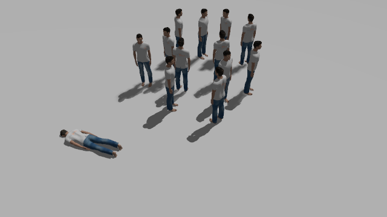
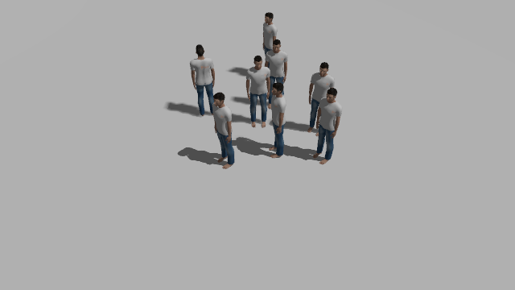

# Example samples

Each sample: the frame all systems saw, the ground truth (for scoring only), and
each system's output. Generated by scripts/paper_figures.sh.

## Scene 1: emergency



Ground truth: 13 people (1 lying), label **emergency**.

**rule**: 0.043 s, YOLO 12 persons

```json
{
  "person_detected": true,
  "persons_count": 12,
  "confidence": 0.887,
  "situation": null,
  "emergency_description": "",
  "surrounding_features": "",
  "recommended_actions": []
}
```

**agentic_qwen3-vl-8b**: 19.811 s, YOLO 12 persons, 1980 tokens

```json
{
  "person_detected": true,
  "persons_count": 13,
  "confidence": 0.95,
  "situation": "emergency",
  "emergency_description": "A person lying motionless on the ground to the left of the crowd",
  "surrounding_features": "Open ground with no obstacles; crowd standing in a circle; clear access for landing",
  "recommended_actions": [
    "HOVER_AND_OBSERVE",
    "ALERT_EMERGENCY_SERVICES"
  ]
}
```

**agentic_qwen3-vl-8b_run2**: 26.430 s, YOLO 12 persons, 2644 tokens

```json
{
  "person_detected": true,
  "persons_count": 13,
  "confidence": 0.95,
  "situation": "emergency",
  "emergency_description": "A person lying motionless on the ground to the left of the crowd.",
  "surrounding_features": "Open ground with no obstacles; crowd standing in a circle; access for landing is possible.",
  "recommended_actions": [
    "ALERT_EMERGENCY_SERVICES"
  ]
}
```

## Scene 2: normal



Ground truth: 8 people (0 lying), label **normal**.

**rule**: 0.020 s, YOLO 8 persons

```json
{
  "person_detected": true,
  "persons_count": 8,
  "confidence": 0.91,
  "situation": null,
  "emergency_description": "",
  "surrounding_features": "",
  "recommended_actions": []
}
```

**agentic_qwen3-vl-8b**: 39.962 s, YOLO 8 persons, 4014 tokens

```json
{
  "person_detected": true,
  "persons_count": 8,
  "confidence": 0.95,
  "situation": "normal",
  "emergency_description": "",
  "surrounding_features": "crowd of standing people, clear ground with no visible obstacles, open space allowing access for landing",
  "recommended_actions": [
    "CONTINUE_MONITORING"
  ]
}
```

**agentic_qwen3-vl-8b_run2**: 11.255 s, YOLO 8 persons, 1089 tokens

```json
{
  "person_detected": true,
  "persons_count": 8,
  "confidence": 0.95,
  "situation": "normal",
  "emergency_description": "",
  "surrounding_features": "crowd of standing people, flat ground with no visible obstacles, clear access for landing",
  "recommended_actions": [
    "CONTINUE_MONITORING"
  ]
}
```

